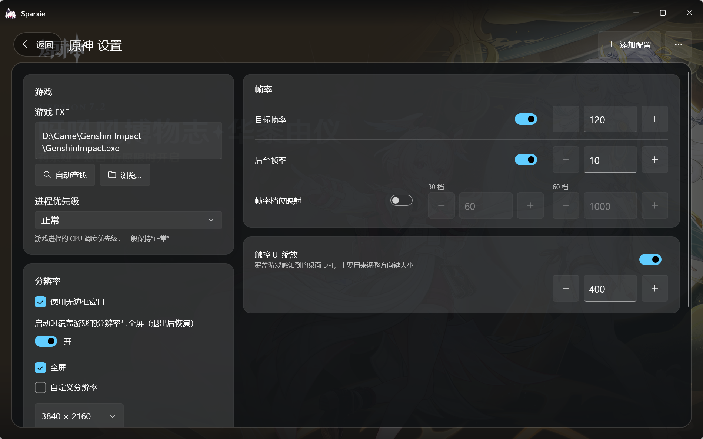
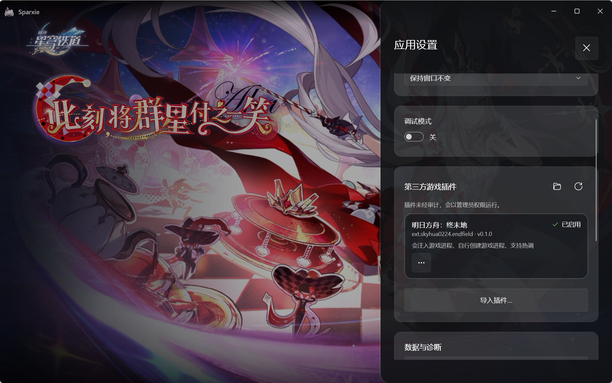

<p align="center">
  
</p>

<h1 align="center">Sparxie</h1>

<p align="center">
  面向触屏与串流设备的 Windows 游戏启动器（WinUI 3）
</p>

<p align="center">
  <a href="https://github.com/sparxie-dev/Sparxie/releases/latest">
    
  </a>
  
  <a href="LICENSE">
    
  </a>
</p>

Sparxie 统一管理 **原神**、**崩坏：星穹铁道**、**绝区零** 以及第三方插件游戏的安装配置与运行会话，由提权运行的 `Broker` 与独立 `SessionHost` 负责触屏运行时注入、帧率解锁与会话生命周期管理。

## 界面预览

| 主页 | 多游戏与多配置切换 |
| :---: | :---: |
|  |  |

| 游戏设置 | 第三方游戏插件 |
| :---: | :---: |
|  |  |

## 特性

- **内置三款游戏开箱即用**：支持原神、崩坏：星穹铁道、绝区零的触屏界面启动；原神与星铁支持可选帧率解锁（默认 120）、运行中目标帧率热调、后台限帧与进程优先级调整；绝区零使用经 SHA-256 校验的固定版本触屏 Runtime。
- **第三方游戏插件（实验性）**：支持在设置页导入插件（`.zip`、文件夹或拖放），核对哈希与风险说明后启用；插件游戏支持多配置、声明式设置表单、自动查找、图标与背景（支持静态图与动态视频）。主发布包不包含任何第三方插件，详见 [`docs/PLUGINS.md`](docs/PLUGINS.md)。
- **多配置与自动保存**：同一游戏可维护多套配置（Profile），所有修改即时保存；支持自动扫描本机安装路径并标出已被其他配置使用的路径。
- **会话安全与配置容错**：启动失败在主页直接展示原因与建议，支持一键复制诊断信息；`Running` 前异常自动清理本次创建的进程，`Running` 后保留游戏进程；`config.json` 逐条校验与修复，单条异常配置不会清空整份列表（见 [`docs/CONFIG-RECOVERY.md`](docs/CONFIG-RECOVERY.md)）。
- **便捷的桌面体验**：单实例运行（重复启动时自动唤回已有窗口）、可配置关闭行为（退出前确认 / 最小化到托盘 / 直接退出）、自适应深浅色与触屏交互。
- **外部启动器集成**：支持 Sunshine 等外部启动器通过 Broker gRPC 发起会话，并提供顶层 `disableTouchUi` 开关（原神/星铁关闭触屏并保留帧率解锁、绝区零跳过 DLL 注入直启、插件通过 ABI 1.1 可选支持）。

## 下载与使用

1. 前往 [GitHub Releases](https://github.com/sparxie-dev/Sparxie/releases/latest) 下载 `Sparxie-desktop-<版本>-win-x64.zip`（Windows 10/11 x64，自包含，无需另装 .NET）。
2. 解压到任意可写目录后运行 `Sparxie.exe`（壳启动器，负责拉起 `app-<版本>\Sparxie.Desktop.exe`）。
3. 升级时先退出 Sparxie，将新版本压缩包解压覆盖到原目录即可，现有配置与设置会自动保留。

> 启动游戏时会弹出 UAC 提权提示（运行时注入与帧率解锁需要管理员权限）。若 Sparxie 放在需要管理员权限的目录下，保存配置与管理插件也需要管理员权限。

### 便携目录布局

所有运行数据均存放在 `Sparxie.exe` 同级目录：

```text
<Sparxie 目录>/
├─ Sparxie.exe           # 壳启动器
├─ version.ini           # 指向当前 app-<版本>
├─ app-<版本>/            # Desktop、Broker、SessionHost 与内置运行时
├─ config.json           # 游戏配置与界面偏好
├─ plugins/              # 用户自行导入的第三方插件（可选）
├─ plugin-trust.json     # 第三方插件信任与哈希确认记录
├─ logs/                 # 滚动日志
└─ cache/                # 图标与背景缓存
```

## 第三方插件

- **导入与启用**：打开「设置 → 第三方游戏插件」，拖入或选择插件 `.zip` / 文件夹；启用前界面会展示插件来源、`module.dll` 与 `plugin.json` 的 SHA-256 哈希以及能力/风险提示。
- **安全说明**：第三方插件未经 Sparxie 审计且无沙箱，启用后会以管理员权限运行原生代码，请只启用你信任来源的插件。
- **插件开发**：可使用 [plugin-template](https://github.com/sparxie-dev/plugin-template) 创建插件仓库，C ABI 头文件位于 [`native/plugin-abi/include/sparxie_game_module.h`](native/plugin-abi/include/sparxie_game_module.h)（MIT 许可），完整规范见 [`docs/PLUGINS.md`](docs/PLUGINS.md)。

## 本地构建与打包

### 环境要求

- Windows 10 / 11 x64
- [.NET 10 SDK](https://dotnet.microsoft.com/)
- Visual Studio 2022 / 2026（含 C++ 桌面开发与 CMake，用于编译 `HoyoTouchCore.dll`）
- Python 3.11+（用于下载并校验固定版本的 ZZZ Runtime）

### 构建、测试与打包

```powershell
# 1. 编译原生 HoyoTouchCore.dll
cmake -G "Visual Studio 18 2026" -A x64 -S native/HoyoTouchCore -B native/HoyoTouchCore/build
cmake --build native/HoyoTouchCore/build --config Release

# 2. 下载并校验固定版本 ZZZ Runtime
python build/package_runtime.py download-runtime --destination zzz-runtime.zip
python build/package_runtime.py prepare-runtime --archive zzz-runtime.zip --destination runtime/zzz

# 3. 构建并运行全部测试
dotnet build Sparxie.slnx -c Release
Copy-Item native/HoyoTouchCore/build/Release/HoyoTouchCore.dll tests/HoyoAbi.Tests/bin/Release/net10.0/ -Force
dotnet test Sparxie.slnx -c Release --no-build

# 4. 生成发布 ZIP
powershell -File build/package_desktop.ps1 -Version 0.2.1 -RuntimeDirectory runtime/zzz -OutputDirectory artifacts
```

`prepare-runtime` 会严格校验 Runtime 哈希与清单文件；发布包审计测试会验证产物包含壳启动器、Desktop、Broker、SessionHost、HoyoTouchCore 与固定 ZZZ Runtime，且不含 PDB、插件或凭据痕迹。

## 仓库结构

```text
Sparxie/
├─ Sparxie.slnx
├─ src/
│  ├─ Sparxie.Desktop/        # WinUI 3 桌面应用
│  ├─ Sparxie.Shell/          # 原生壳启动器（读取 version.ini）
│  ├─ Sparxie.LauncherCore/   # 无界面启动器核心（Profile 管理、Broker 客户端）
│  ├─ Sparxie.Broker/         # 管理员 Broker（gRPC 命名管道服务）
│  ├─ Sparxie.SessionHost/    # 按游戏独立运行的会话宿主
│  ├─ Sparxie.Contracts/      # Profile / gRPC / 错误契约
│  └─ Sparxie.Infrastructure/ # 配置、插件加载、注册表钩子与进程工具
├─ native/
│  ├─ HoyoTouchCore/          # Hoyo 上游 subtree + 适配层
│  └─ plugin-abi/             # 第三方游戏模块 C ABI（MIT 许可）
├─ build/                     # Runtime 校验、本地构建与发布打包脚本
├─ docs/                      # 架构、插件规范、配置恢复与 UX 文档
├─ assets/                    # 应用图标与品牌资源
└─ tests/                     # 单元测试、ABI 测试、Broker 集成与发布包审计
```

## 相关文档

- [`docs/ARCHITECTURE.md`](docs/ARCHITECTURE.md) — 进程边界、会话状态机与通信架构
- [`docs/PLUGINS.md`](docs/PLUGINS.md) — 第三方插件清单、信任机制与 C ABI 1.1 规范
- [`docs/CONFIG-RECOVERY.md`](docs/CONFIG-RECOVERY.md) — `config.json` 逐条读取、修复与备份策略
- [`docs/RUNTIME-NOTICE.md`](docs/RUNTIME-NOTICE.md) — 运行时组件与合规说明

## 许可

- 本仓库自有组件采用 **GNU GPLv3**，详见 [`LICENSE`](LICENSE)。
- 绝区零闭源 Runtime 为独立组件，通过 [`LICENSE-EXCEPTION.txt`](LICENSE-EXCEPTION.txt)（GPLv3 第 7 条附加许可）与 Sparxie 一起分发。
- 插件 C ABI 目录（`native/plugin-abi/`）采用 **MIT** 许可，详见 [`native/plugin-abi/LICENSE`](native/plugin-abi/LICENSE)。
- 第三方组件许可与版权声明见 [`THIRD-PARTY-NOTICES.md`](THIRD-PARTY-NOTICES.md)。
